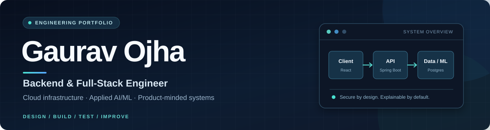

# Gaurav Ojha

**Backend & Full-Stack Software Engineering · Cloud Infrastructure · Applied AI/ML**

I build practical software products with a focus on reliable APIs, clear interfaces, thoughtful data models, and explainable machine learning.

  
  
  

[Featured project](#featured-project--civicresolve-ai) · [Selected work](#selected-work) · [Tech stack](#technical-toolkit) · [About](#about-me)

---

## Featured project · CivicResolve AI

**A consumer grievance intelligence platform bringing complaint intake, explainable NLP-assisted triage, and human review into a single workflow.**

| Engineering focus | Implementation |
| --- | --- |
| **End-to-end product** | React + TypeScript frontend, Spring Boot REST API, FastAPI NLP microservice, PostgreSQL |
| **Explainable ML** | TF-IDF and Logistic Regression production classifier; separate BiLSTM benchmarking |
| **Responsible workflows** | Human-in-the-loop reviewer decisions, PII scrubbing, audit trails and tracked case status |
| **Defensive backend** | Role-separated database access, credential hashing, rate limiting and concurrency controls |

**Architecture:** React / TypeScript → Spring Boot → FastAPI NLP → PostgreSQL

[**Explore source and setup instructions**](https://github.com/Gaurav-Ojha65/CivicResolveAI) · [Architecture](https://github.com/Gaurav-Ojha65/CivicResolveAI/blob/main/docs/ARCHITECTURE.md) · [Security design](https://github.com/Gaurav-Ojha65/CivicResolveAI/blob/main/docs/SECURITY.md) · [Testing guide](https://github.com/Gaurav-Ojha65/CivicResolveAI/blob/main/docs/TESTING.md)

---

## Selected work

Different problems, different trade-offs. Each repository includes the implementation and a closer look at the engineering decisions.

| Project | What it demonstrates | Core technologies |
| --- | --- | --- |
| **[Real-Time ASL Gesture Recognition](https://github.com/Gaurav-Ojha65/ASL-Gesture-Recognition)** | Webcam-based hand landmark classification with a temporal state machine for stable fingerspelling | Python, MediaPipe, PyTorch, OpenCV |
| **[Highly Available Three-Tier AWS](https://github.com/Gaurav-Ojha65/ha-three-tier-aws)** | Multi-AZ network and application infrastructure managed with Terraform and Ansible | AWS, Terraform, Ansible, EC2, RDS |
| **[AI Mortgage Decision System](https://github.com/Gaurav-Ojha65/AI_Mortgage_Decision_System)** | Research prototype for risk modeling, SHAP explanations, scenarios and fairness analysis; not a production lending service | FastAPI, React, XGBoost, LightGBM, SHAP |
| **[CollegeFind](https://github.com/Gaurav-Ojha65/CollegeFind)** | College discovery and comparison product with account features and historical cutoff-based insights | Next.js, Node.js, Express, PostgreSQL |

> I value projects that can be explained, tested, and reproduced, not just presented as screenshots.

---

## Technical toolkit

| Area | Technologies |
| --- | --- |
| **Backend and APIs** | Java, Spring Boot, Python, FastAPI, Node.js, Express, REST, SQL |
| **Frontend** | React, Next.js, TypeScript, JavaScript, Tailwind CSS, Vite |
| **Cloud and infrastructure** | AWS, Docker, Terraform, Ansible, Linux, GitHub Actions |
| **Data and ML** | PostgreSQL, MySQL, scikit-learn, PyTorch, XGBoost, LightGBM, SHAP, MediaPipe |
| **Engineering practices** | Automated testing, API design, secure data handling, documentation, reproducible environments |

## About me

I'm a **B.Tech Computer Science student at Lovely Professional University**, with an **AI/ML minor**. My interests sit at the intersection of backend architecture, accessible user experiences, cloud-native infrastructure, and practical machine learning.

- **Certification:** AWS Certified Cloud Practitioner
- **Problem-solving practice:** 400+ problems across LeetCode and HackerRank
- **What matters to me:** Clear trade-offs, honest limitations, and software that can be maintained beyond a demo

## Let's connect

I'm interested in backend and full-stack engineering, cloud infrastructure, and applied AI/ML projects.

**[Portfolio](https://gaurav-ojha-portfolio.netlify.app) · [LinkedIn](https://www.linkedin.com/in/gaurav-ojha18/) · [Email](mailto:gauravojhavaranasi@gmail.com) · [All repositories](https://github.com/Gaurav-Ojha65?tab=repositories)**

Project descriptions reflect the documented implementations in their respective repositories. Benchmarks, demos and production readiness should be evaluated from each project's own documentation.
