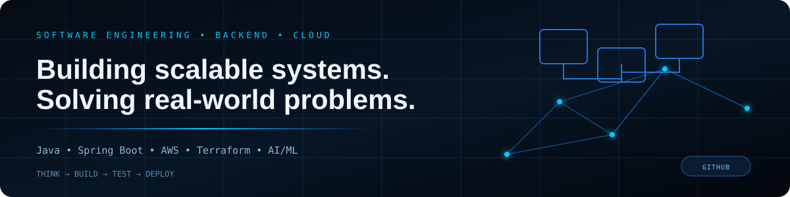

# Gaurav Ojha

**Backend & Full-Stack Software Engineering**

Java · Spring Boot · Python · React · AWS · Applied AI/ML

  
  
  

  <a href="#about">About</a> ·
  <a href="#technical-focus">Technical focus</a> ·
  <a href="#featured-work">Featured work</a> ·
  <a href="#github-activity">GitHub activity</a> ·
  <a href="#lets-connect">Connect</a>

---

## About

I'm a **B.Tech Computer Science student at Lovely Professional University**, with an **AI/ML minor**. I like building practical software systems where backend design, data, security, and a usable interface come together.

My work spans full-stack applications, backend services, cloud infrastructure, and applied machine learning. I care about clear architecture, reproducible setup instructions, meaningful tests, and documenting limitations—not just getting a demo to run.

- **Credential:** AWS Certified Cloud Practitioner
- **Problem solving:** 400+ coding problems across LeetCode and HackerRank
- **Current direction:** Backend engineering, full-stack development, and cloud-native systems

## Technical focus

| Backend & languages | Frontend | Cloud & data | Applied AI/ML |
|---|---|---|---|
| Java · Spring Boot | React · Next.js | AWS · Docker | Python · scikit-learn |
| Python · FastAPI | TypeScript · JavaScript | Terraform · Ansible | XGBoost · LightGBM |
| Node.js · Express | Tailwind CSS · Vite | PostgreSQL · MySQL | PyTorch · MediaPipe · SHAP |
| REST APIs · SQL | HTML · CSS | Linux · GitHub Actions | NLP · Model evaluation |

---

## Featured work

The projects below are selected for the engineering problems they demonstrate. Expand any project to see its architecture, implementation details, and repository.

<strong>01 · CivicResolve AI</strong> — Consumer grievance intelligence platform

A multi-service application for financial complaint intake, NLP-assisted triage, reviewer workflows, and auditable case handling.

**What it demonstrates**
- React + TypeScript client, Spring Boot API, FastAPI NLP service, and PostgreSQL persistence.
- Explainable TF-IDF + Logistic Regression classification, with a separate BiLSTM benchmark.
- Human-in-the-loop review, PII scrubbing, audit trails, and least-privilege database roles.
- Separate backend, frontend, and NLP test suites documented in the repository.

**Architecture**

`React / TypeScript → Spring Boot REST API → FastAPI NLP service → PostgreSQL`

**Stack:** Java · Spring Boot · React · TypeScript · Python · FastAPI · PostgreSQL · scikit-learn · PyTorch

[Open repository](https://github.com/Gaurav-Ojha65/CivicResolveAI)

<strong>02 · Real-Time ASL Gesture Recognition</strong> — Webcam-based fingerspelling

A real-time system that turns hand gestures into text using landmark-based classification and temporal control logic.

**What it demonstrates**
- MediaPipe extracts 21 3D hand landmarks; preprocessing normalizes hand geometry and handedness.
- A lightweight PyTorch MLP classifies gestures from the normalized landmark vector.
- A temporal finite-state machine manages dwell time, release debounce, and character commitment.
- Includes a separate CNN benchmark for the Sign Language MNIST dataset.

**Pipeline**

`Webcam → MediaPipe landmarks → Normalization → PyTorch MLP → Temporal FSM → Text buffer`

**Stack:** Python · MediaPipe · PyTorch · OpenCV · NumPy · pytest

[Open repository](https://github.com/Gaurav-Ojha65/ASL-Gesture-Recognition)

<strong>03 · AI Mortgage Decision System</strong> — Explainable risk assessment prototype

A **research and portfolio prototype** for AI-assisted mortgage risk assessment and decision support. It is not a production credit approval service.

**What it demonstrates**
- XGBoost, LightGBM, and Logistic Regression experimentation with ensemble inference.
- SHAP-based explanations and Monte Carlo scenario simulation.
- OCR document extraction and fairness auditing.
- FastAPI backend with a React interface.

**Stack:** Python · FastAPI · React · XGBoost · LightGBM · scikit-learn · SHAP · SQLite

[Open repository](https://github.com/Gaurav-Ojha65/AI_Mortgage_Decision_System) · [Try live demo](https://ai-mortgage-decision-system-pied.vercel.app)

<strong>04 · Highly Available Three-Tier AWS Infrastructure</strong> — Infrastructure as Code

A multi-AZ AWS environment provisioned with Terraform and configured through Ansible.

**What it demonstrates**
- VPC with public and private subnets across two Availability Zones.
- Application Load Balancer, private EC2 web tier, RDS for MySQL, NAT gateways, and bastion access.
- Terraform provisions infrastructure; Ansible configures Nginx and verifies connectivity.
- Includes deployment, verification, cost, and teardown guidance.

**Flow**

`Internet → ALB → Private EC2 web tier → Private RDS`

**Stack:** AWS · VPC · EC2 · ALB · RDS · Terraform · Ansible

[Open repository](https://github.com/Gaurav-Ojha65/ha-three-tier-aws)

<strong>05 · CollegeFind</strong> — Full-stack college discovery platform

A deployed application for searching and comparing colleges using fees, placements, rankings, courses, and historical cutoff data.

**What it demonstrates**
- Next.js frontend with a Node.js/Express REST API.
- PostgreSQL on Supabase, JWT authentication, and saved colleges.
- Cutoff-based rank prediction using historical closing-rank data.
- Separate frontend and backend deployments.

**Stack:** Next.js · React · Node.js · Express · PostgreSQL · Supabase · JWT

[Open repository](https://github.com/Gaurav-Ojha65/CollegeFind) · [Open live application](https://college-find-one.vercel.app)

<a href="#top">Back to top ↑</a>

---

## GitHub activity

I keep this section lightweight and reliable rather than depending on third-party statistics images that may stop loading.

**Explore by project:** [CivicResolve AI](https://github.com/Gaurav-Ojha65/CivicResolveAI) · [ASL Recognition](https://github.com/Gaurav-Ojha65/ASL-Gesture-Recognition) · [Mortgage AI](https://github.com/Gaurav-Ojha65/AI_Mortgage_Decision_System) · [CollegeFind](https://github.com/Gaurav-Ojha65/CollegeFind) · [AWS Infrastructure](https://github.com/Gaurav-Ojha65/ha-three-tier-aws)

GitHub's native contribution calendar and repository insights are available directly on my [profile](https://github.com/Gaurav-Ojha65).

---

## Let's connect

I'm interested in conversations about backend engineering, full-stack applications, cloud infrastructure, and practical AI/ML.

---

Built with care. Focused on practical engineering, transparent documentation, and continuous improvement.
