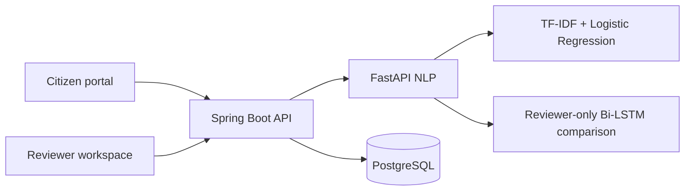

# CivicResolve AI | Backend and ML engineering case study

**Repository:** [Gaurav-Ojha65/CivicResolveAI](https://github.com/Gaurav-Ojha65/CivicResolveAI)  
**Stack:** Spring Boot, FastAPI, PostgreSQL, React/TypeScript, scikit-learn  
**Scope:** Documented portfolio system, not a claim of deployment by a regulated financial institution

## The problem

Complaint triage is more than classifying text. A useful application must protect sensitive narratives, handle model uncertainty, manage competing reviewer updates, and provide a safe public case-tracking workflow.

The system deliberately separates presentation, case state, and inference:

- **React** implements citizen submission/tracking and the protected reviewer workspace.
- **Spring Boot** owns API access, state transitions, tracking secrets, persistence, and review transactions.
- **FastAPI** handles NLP inference, feature attribution, and reviewer-only model comparison.
- **PostgreSQL** remains the source of truth for grievance records.

[Read the architecture specification](https://github.com/Gaurav-Ojha65/CivicResolveAI/blob/main/docs/ARCHITECTURE.md).

## Decision 1: keep ML decisions interpretable

The authoritative intake model uses TF-IDF (uni-/bigrams) and balanced Logistic Regression to classify eight complaint categories. A Bi-LSTM is retained as a **reviewer-only challenger**, not the source of automatic routing decisions.

The repository records these results on a **12,726-example stratified validation split**:

| Validation metric | TF-IDF / Logistic Regression | Bi-LSTM challenger |
| --- | ---: | ---: |
| Accuracy | 83.80% | 81.24% |
| Macro F1 | 0.7453 | 0.7067 |

Accuracy alone would obscure weaker results on smaller classes: credit-reporting complaints form approximately 64.7% of the curated corpus. Macro F1 therefore provides an important complementary measure.

The linear classifier can expose deterministic token-level contributions from its feature weights. Reviewers can inspect these contributions and compare outcomes without treating probability estimates as calibrated certainty.

**Trade-off:** an interpretable baseline supports reviewability, but class imbalance, domain shift, and uncalibrated confidence remain limitations. These values are validation results, not real-world SLA or accuracy guarantees.

[Read the model card and evaluation limitations](https://github.com/Gaurav-Ojha65/CivicResolveAI/blob/main/docs/MODEL_CARD.md).

## Decision 2: isolate public tracking from privileged review

Citizens track grievances without signing up for a conventional account. That requires a separate possession proof beyond an easy-to-guess grievance ID.

The documented design generates a **32-byte random tracking secret**, returns it once, persists only a salted SHA-256 digest, and uses constant-time comparison for verification. Public tracking responses omit internal reviewer notes and sensitive analysis.

Layered controls include:

1. **Bounded, fail-closed rate limiting** on public tracking attempts.
2. **Spring Security** and BCrypt-hashed passwords on reviewer endpoints.
3. **Distinct database roles** for Flyway migrations and the application runtime, limiting schema-changing privileges.
4. **In-memory frontend reviewer credentials** instead of long-lived browser storage.

**Trade-off:** a one-time token simplifies citizen access while requiring careful handling by the person receiving it. The user-facing public timeline must expose less than a reviewer can see.

[Read the security design](https://github.com/Gaurav-Ojha65/CivicResolveAI/blob/main/docs/SECURITY.md).

## Decision 3: protect concurrent review decisions

Two reviewers can load the same case and make conflicting decisions. Silent last-write-wins updates could erase a previous action.

The backend uses **JPA optimistic locking** via `@Version`. A stale update receives **HTTP 409 Conflict**, prompting the client to refresh the case instead of overwriting a more recent version.

**Trade-off:** the reviewer may need an extra refresh, but data integrity is more important than hiding collisions.

## How to verify the work

The repository has three distinct CI checks:

| Component | Verification |
| --- | --- |
| Frontend | TypeScript validation, Vitest, production build |
| Backend | Maven `verify` with PostgreSQL integration tests and separate runtime/migration roles |
| NLP service | Pytest, model-artifact and API tests, dependency consistency |

GitHub Actions executes the test tracks but does **not** deploy the application. Integration checks require an isolated test database rather than production credentials.

[Testing guide](https://github.com/Gaurav-Ojha65/CivicResolveAI/blob/main/docs/TESTING.md) · [CI configuration](https://github.com/Gaurav-Ojha65/CivicResolveAI/blob/main/.github/workflows/ci.yml).

## Lessons and next improvements

This project illustrates the distinction between **building an ML demonstration** and **engineering a safe workflow around an ML model**. The important decisions are ownership of persisted state, explicit access boundaries, conflict handling, and reporting evaluation limitations.

Potential next improvement: make the frontend API wrapper explicitly remove a caller-supplied `Authorization` header on public endpoints. This is a proposed security hardening, **not a fix already merged to CivicResolve AI**.

Before real-world use, the system would also need external model evaluation, operational monitoring, independent security assessment, and incident procedures.
